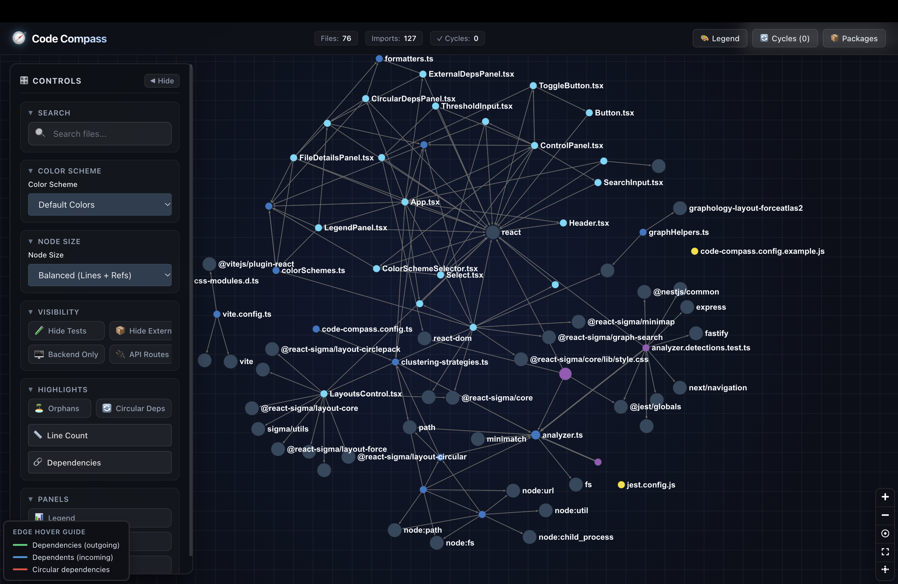

# 🧭 Code Compass

Interactive architectural mapping and dependency graph visualizer for modern JavaScript and TypeScript codebases. Automatically detects circular imports, parses frameworks (Next.js, Express, NestJS), and generates a standalone interactive HTML map.



---

## ✨ Features

- **Interactive 2D Graph**: WebGL-powered canvas with zoom, pan, search, and blueprint dark grid.
- **Circular Dependency Detection**: Pinpoints and highlights import cycles in bright red.
- **Framework & Component Aware**: Detects Next.js (App Router, Server/Client components) and Node.js backends (Express, NestJS, Fastify).
- **Collapsible Controls**: Sleek sidebar dock with one-click full-screen canvas view (`◀ Hide`).
- **Portable Single-File Output**: Bakes everything into a standalone `code-compass.html` that opens anywhere without a server.

---

## 🚀 Installation & Setup

1. **Clone the repository**:
   ```bash
   git clone https://github.com/asutekku/project-visualizer.git code-compass
   cd code-compass
   ```

2. **Install dependencies**:
   ```bash
   pnpm install
   ```

3. **Build the project**:
   ```bash
   pnpm run build:all
   ```

---

## 💻 Usage

### Analyze a Project
Analyze your current project or any target directory on your machine:

```bash
# 1. Install & build
pnpm install
pnpm run build:all

# 2. Analyze a project
pnpm run compass . --ignore-builds

# 3. Open in browser (macOS)
open code-compass.html
```

> **Tip:** You can analyze any external directory: `pnpm run compass /path/to/any-project --ignore-builds`

---

## ⚙️ CLI Options

| Option | Description |
| :--- | :--- |
| `--ignore-builds` | Skip build directories (`dist`, `.next`, `build`, `node_modules`) |
| `--color-scheme <scheme>` | Color palette: `default` or `nextjs` |
| `--output <file>` | Custom output filename (default: `code-compass.html`) |
| `--density-threshold <n>` | Files per cluster before subdivision (default: `15`) |
| `--no-framework-detection` | Disable framework-specific clustering |

---

## 🛠️ Configuration

Create `code-compass.config.js` in your project root to set defaults:

```javascript
export default {
  colorScheme: 'default',
  ignoreBuildDirs: true,
  outputFile: 'code-compass.html'
};
```

---

## 🎮 Controls

- **Mouse Wheel / Drag**: Zoom and pan across the network graph.
- **Click Node**: Inspect file size, lines of code, and imports in the details drawer.
- **Hover Node**: Highlights connected dependencies and shows filename capsule.
- **`◀ Hide` / `🎛️ Controls`**: Toggle sidebar for full-screen exploration.
- **Top Bar**: Quick toggles for **🎨 Legend**, **🔄 Cycles**, and **📦 Packages**.

---
